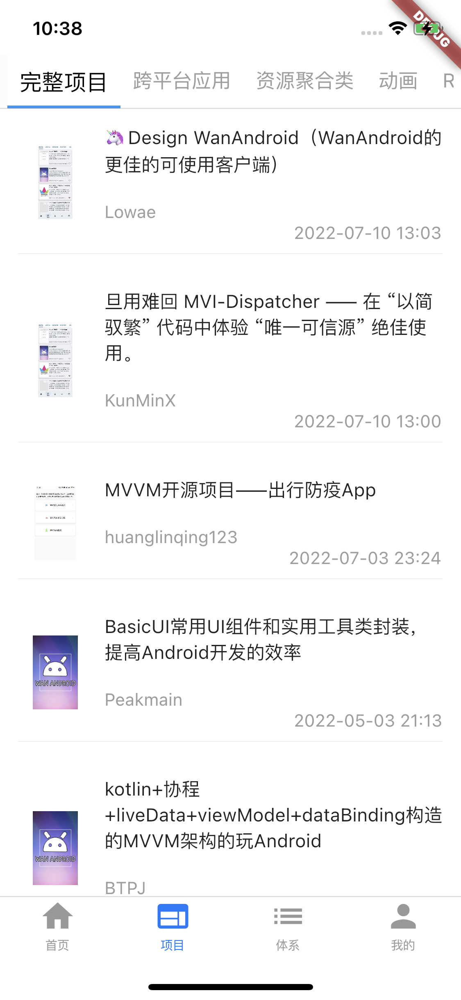
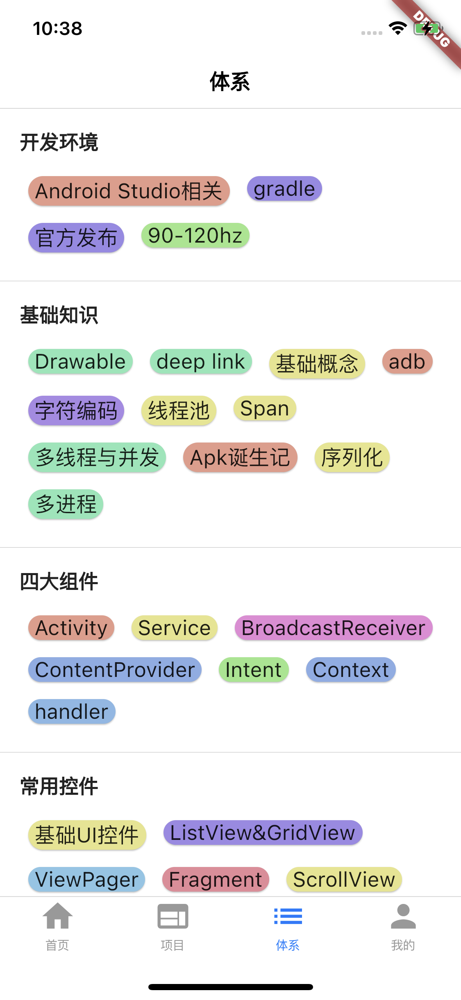
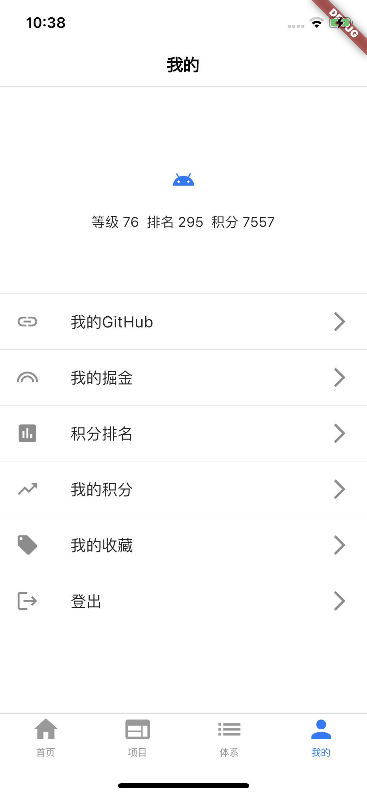
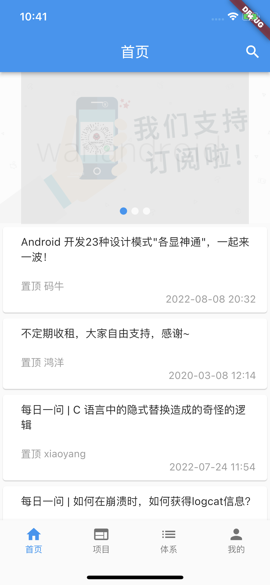
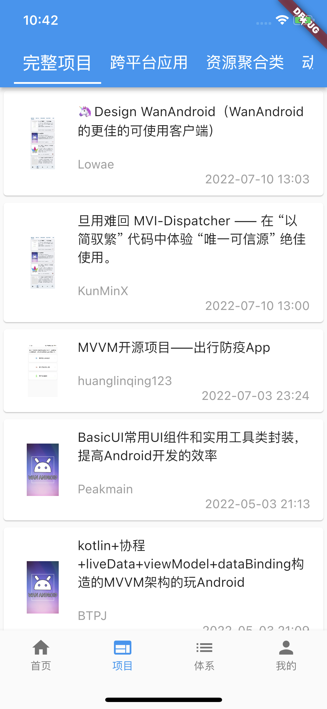
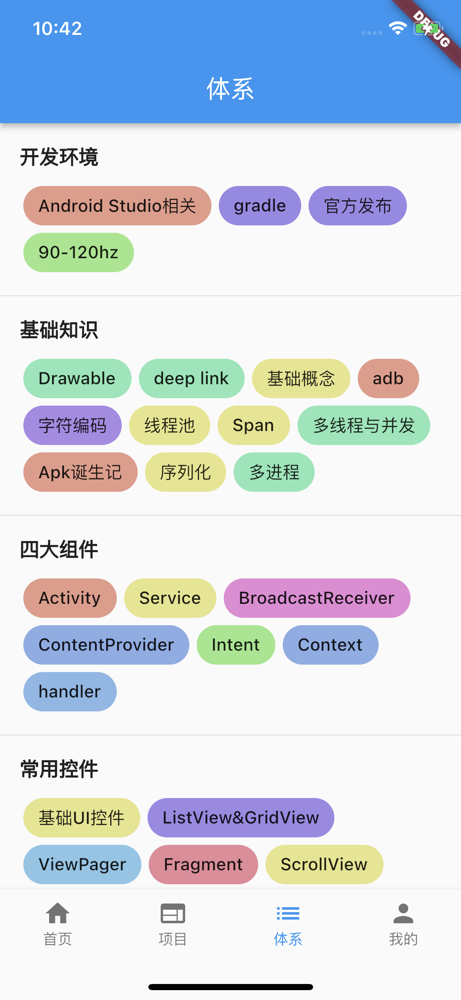
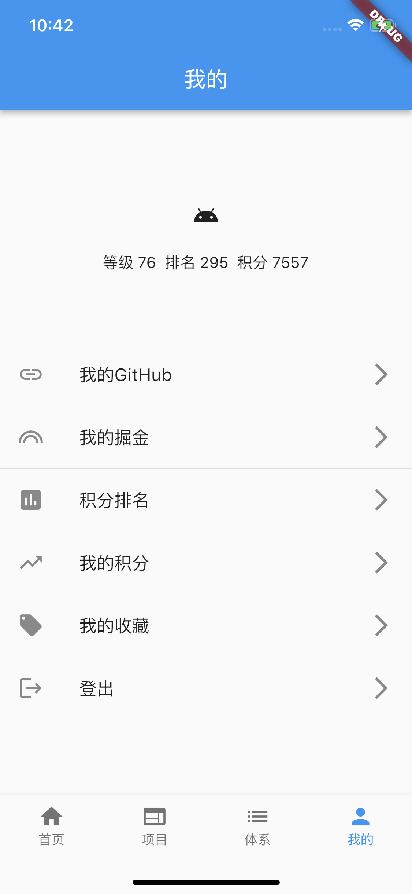

# GetXStudy · WanAndroid 客户端

基于 [WanAndroid 开放 API](https://www.wanandroid.com/) 的 Flutter/GetX 学习项目，通过文章阅读、分类浏览和账户功能，实践 GetX 的状态管理、路由与依赖注入。

当前主要维护 Cupertino 界面，面向 Android 和 iOS。Material 界面截图作为历史展示，不代表两套界面持续同步维护；仓库中的其他平台目录也不代表已经完成适配。

[功能介绍](#功能介绍) · [快速开始](#快速开始) · [代码组织](#代码组织) · [开发维护](#开发维护) · [项目文档](#项目文档)

## 功能介绍

| 模块 | 功能 |
| --- | --- |
| 首页 | 横幅轮播、置顶文章、文章分页、搜索入口 |
| 项目 | 项目分类、Tab 切换、分类文章分页 |
| 公众号 | 公众号切换、文章列表与分页 |
| 体系 | 知识体系导航、分类文章浏览 |
| 我的 | 登录、注册、退出、收藏管理、积分排名与积分历史 |

列表支持下拉刷新和分页加载；搜索支持热门关键词及提交关键词查询。文章通过 WebView 阅读，并提供收藏、取消收藏和分享操作。应用内容依赖 WanAndroid 服务及网络可用性。

## 快速开始

### 环境准备

- 当前验证环境为 **Flutter 3.47.0 stable**，与根目录 [.flutter-version](.flutter-version) 及 CI 配置一致；Dart 使用该 Flutter SDK 自带版本。
- [pubspec.yaml](pubspec.yaml) 中的 Dart SDK 约束为 `^3.0.0`，这是声明的约束，不表示所有对应 Flutter 版本均已验证。
- Android 开发需准备 Android SDK；iOS 开发需使用 macOS、Xcode 和 CocoaPods，真机运行还需配置签名。

先确认本地 SDK 版本及工具链状态：

```bash
flutter --version
flutter doctor
```

### 获取与运行

```bash
git clone https://github.com/seasonZhu/GetXStudy.git
cd GetXStudy
flutter pub get
flutter devices
```

从 `flutter devices` 输出中选择 Android 或 iOS 设备，将以下占位符替换为实际设备 ID：

```bash
flutter run -d <设备ID>
```

默认入口为 `lib/main.dart`。仓库已跟踪所需的生成代码，首次运行无需先执行代码生成。

## 代码组织

| 技术 | 用途 |
| --- | --- |
| Flutter / Cupertino | 页面与交互展示 |
| GetX | 状态管理、路由、依赖注入与生命周期管理 |
| Dio / Retrofit | HTTP 请求封装及声明式接口 |
| SharedPreferences / Flutter Secure Storage | 本地偏好与存储工具；具体数据使用方式以服务实现为准 |
| pull_to_refresh / card_swiper | 列表刷新、分页与轮播 |
| webview_flutter / share_plus | 文章阅读与分享 |
| build_runner / json_serializable | 部分接口和模型的代码生成 |

依赖声明以 [pubspec.yaml](pubspec.yaml) 为准，实际解析版本见 [pubspec.lock](pubspec.lock)。

页面按业务模块组织，常见调用关系为 View → Controller → Repository。View 负责布局和交互，Controller 管理状态与业务流程，Repository 封装数据获取；Service 承载账户、主题等跨页面能力，Binding 注册路由所需依赖。

项目同时使用 `Obx` 和 `GetBuilder`：前者监听响应式状态，后者通过 `update()` 显式刷新。阅读和修改时沿用所在模块已有方式。

```text
lib/
├── main.dart        # 应用入口
├── app_service/     # 账户、主题等应用服务
├── base/            # 请求、刷新等基类
├── entity/          # 数据模型
├── generated/       # 生成代码与资源索引
├── http_client/     # Retrofit 接口及生成实现
├── http_util/       # 网络请求工具
├── pages/           # 首页、分类、账户、阅读等业务页面
├── resource/        # 应用资源封装
├── routes/          # 路由与依赖绑定
├── util/            # 工具方法
└── widgets/          # 通用组件
```

## 开发维护

### 验证改动

在项目根目录执行：

```bash
flutter analyze --no-fatal-warnings --no-fatal-infos
flutter test
python3 -m unittest discover -s .github/scripts -p 'test_*.py'
```

最后一条命令验证 CI 的 Dart 格式检查范围逻辑，需要 Python 3。以上命令不要求启动模拟器。

本地只检查本次新增或修改的 Dart 文件，手动替换文件路径（可指定多个文件）：

```bash
dart format --output=none --set-exit-if-changed lib/本次修改的文件.dart
```

CI 自动计算变更范围并检查格式：PR 比较 base/head，push 比较 before/当前提交；新分支回退到父提交，无父提交时检查全部已跟踪的 Dart 文件。格式检查不改写源码。

[CI](.github/workflows/ci.yml) 覆盖 `main`、`develop`、`optimize-project`，[Flutter CI](.github/workflows/flutter-ci.yml) 覆盖 `develop_cupertino`。检查包含依赖获取、变更文件格式、格式脚本测试、静态分析和 Flutter 测试。静态分析完整输出诊断，error 必须阻断，已有 warning/info 暂不阻断；格式或测试失败也必须阻断。

本地检查结果与远端 Actions 结果分别确认；远端是否通过，以对应提交的工作流运行结果为准。

### 按需生成代码

修改 Retrofit 接口或使用 `json_serializable` 的模型后，可执行：

```bash
dart run build_runner build
```

检查生成文件差异后再提交。项目也保留了 `lib/generated/json/` 下另一套模型转换代码，不应将所有模型都视为 `json_serializable` 生成；修改前先确认文件使用的注解和生成方式，可参考 [历史开发说明](说明.md)。

## 项目文档

| 入口 | 内容 |
| --- | --- |
| [文档索引](docs/INDEX.md) | 详细文档导航 |
| [架构说明](docs/ARCHITECTURE.md) | 代码组织与设计说明 |
| [API 文档](docs/API_DOCUMENTATION.md) | 请求接口和数据处理说明 |
| [资源常量指南](docs/CONSTANTS_MANAGEMENT.md) | 字符串、颜色及尺寸资源 |

详细文档包含历史设计和阶段性优化记录，部分描述可能与当前实现有差异；当前行为以源码、依赖和工作流配置为准。

## 📸 界面预览

以下为仓库保留的历史截图，仅供界面参考，未反映当前全部功能（例如公众号入口）。

### Cupertino 历史界面

<table>
  <tr>
    <td></td>
    <td></td>
    <td></td>
    <td></td>
  </tr>
</table>

### Material 历史界面（长期未更新）

<table>
  <tr>
    <td></td>
    <td></td>
    <td></td>
    <td></td>
  </tr>
</table>

---

## 💡 GetX 使用心得

> 摘自作者在 Flutter 和响应式编程方面的学习经验

在 Flutter 状态管理的学习路径上，我经历了从 `StatefulWidget` + `setState` 到 `Provider`，再到 `Bloc`/`Redux` 的过程。虽然 `Provider` 设计优秀，但 `Bloc` 和 `Redux` 在我看来确实过于复杂。

**GetX** 的出现很好地平衡了开发效率和代码质量：

### ✅ 优势

- 摆脱 `context` 依赖，`Get.put` / `Get.find` 召之即来挥之即去
- 响应式状态管理与 UI 自动绑定
- 内置路由、依赖注入、工具类，全家桶解决方案
- 对有 RxSwift/Vue 经验的开发者非常友好

### ⚠️ 注意事项

- `GetXController` 的生命周期管理需要谨慎（创建与销毁时机）
- 不太符合 Flutter 传统自顶而下的管理思路
- 需要理解背后的 Map 存储机制

### 📚 学习建议

对于 Flutter 初学者，我建议的学习路径是：

```
StatefulWidget → Provider → GetX
```

这样循序渐进，才能真正理解各框架的设计理念和价值。**所谓一通百通**，我也通过 RxSwift 与 Vue 编写了 wanandroid 客户端，欢迎大家一起学习交流。

---

## 贡献指南

欢迎通过 [GitHub Issues](https://github.com/seasonZhu/GetXStudy/issues) 反馈问题或提出建议，也欢迎提交 Pull Request。

提交时说明问题、修改内容及验证结果；涉及界面变化时可附截图。格式调整限定在本次修改的文件，避免混入无关改动。

## 历史记录

以下为原 README 保留的阶段性记录，不代表新的发布版本。

- **2025年12月26日**：项目架构优化和代码重构。
- **2023年8月15日**：项目/公众号模块复用 Tree 模块，调整状态组件、页面及业务拆分，引入 Dart Retrofit，并抽取 AccountService。

## 🔗 相关项目

| [](https://github.com/seasonZhu/RxStudy) | [](https://github.com/seasonZhu/GetXStudy) | [](https://github.com/seasonZhu/HarmonyStudy) | [](https://github.com/seasonZhu/UniAppPlayAndroid) |
|:---:|:---:|:---:|:---:|
| [Swift 版](https://github.com/seasonZhu/RxStudy) | [Flutter 版](https://github.com/seasonZhu/GetXStudy) | [HarmonyOS 版](https://github.com/seasonZhu/HarmonyStudy) | [uni-app 版](https://github.com/seasonZhu/UniAppPlayAndroid) |

---

## 👨‍💻 作者

**seasonZhu**

- 掘金: [seasonZhu](https://juejin.cn/user/4353721778057997)
- GitHub: [@seasonZhu](https://github.com/seasonZhu)

---

## 📄 许可证

本项目采用 [MIT](LICENSE) 许可证。

---

**如果这个项目对你有帮助，请给一个 ⭐️ 支持一下！**

Made with ❤️ by seasonZhu

## 最后

随着AI时代的到来，其实我也不知道这种开源项目是否还有多少意义？

其实不管是 ⭐️ 还是Fork，在目前来看，对于开源项目都说明不了什么。

我唯一能说的是，这是我来时的路，对我自己而言是珍贵的过程。
